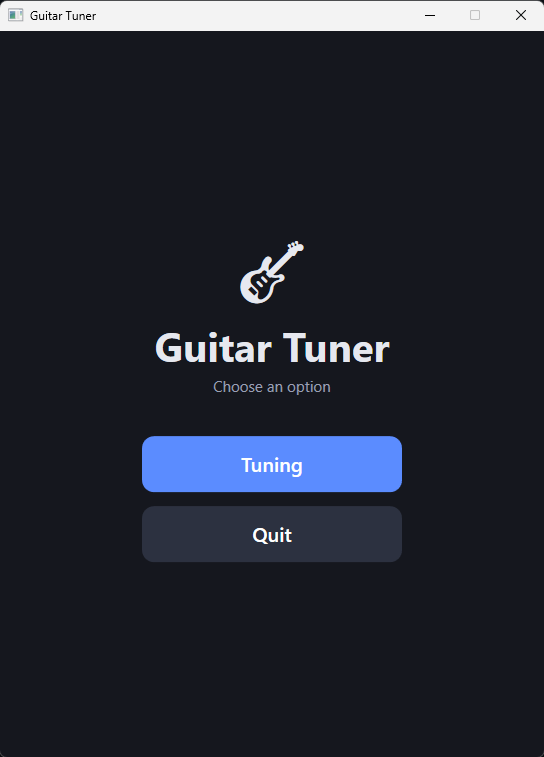
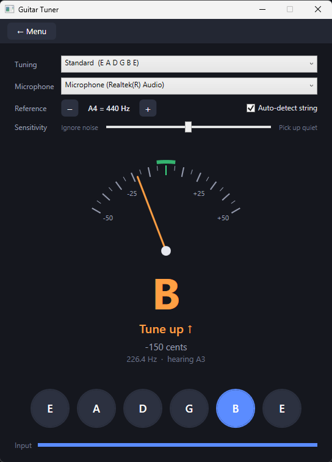

# Guitar Tuner

A GuitarTuna-style guitar tuner for Windows PC. It listens to your microphone, detects the pitch of the string you play, and shows whether to tune up or down.

<p>
  
  
</p>

## Features

- **Start menu:** choose **Tuning**, **Chords**, **Tabs**, **Songs**, **Metronome** or **Quit**.
- **Live tuning gauge:** a needle shows how many cents you are off, with a green ±5 cent "in tune" zone.
- **Clear hints:** "Tune up ↑", "Tune down ↓" or "In tune ✓", colour-coded orange/green.
- **Auto-detect string:** play any string and the tuner picks the nearest one. You can also click a string to lock onto it.
- **Reference tones:** clicking a string plays its target note.
- **14 tunings:** Standard, Drop D, Half Step Down, Full Step Down, C Standard, Drop C, Drop B, Drop A, Open G, Open D, Open E, Open A, Open C, DADGAD.
- **Tabs:** every note you play is written as tablature, with a suggested string and fret and a confidence hint. If you're playing on one string, pick it in the **Play on** box or click one of the **6 E … 1 e** buttons and the app won't guess; keys **6–1** do the same, **0** returns to Auto. Click a note to move it to another string, then undo, clear or copy the whole tab as text. Notes where several positions are almost equally likely are marked **Uncertain** with a dotted outline.
- **Songs:** import a WAV/MP3/FLAC/OGG/AIFF/M4A file and turn the whole performance into tablature. Spotify's Basic Pitch finds the notes and timing; a C# Viterbi/beam-search arranger chooses playable strings and frets, including chords. Tick **Solo** to keep only one note per onset for a single-line part. Tuning changes re-arrange the result without re-running the model. Click a note to move it to the next string, or right-click to remove a wrong note. Copy the tab as text or export MIDI/MusicXML. Dotted notes are positions the arranger is unsure about.
- **Background noise rejection:** an adaptive noise gate plus a stability check, with a **Sensitivity** slider for noisy rooms.
- **Adjustable reference pitch:** A4 from 415 to 466 Hz (default 440 Hz).
- **Microphone selection** and an input level meter (grey = ignored as noise, blue = being analysed).

## Mobile app

The tuner (with custom tunings) and metronome are also available as an Android and iOS app in [`Mobile/`](Mobile/README.md).

## Requirements

- Windows 10 or 11
- [.NET 10 SDK](https://dotnet.microsoft.com/download)
- A microphone
- Python 3.10–3.13 with the packages in `Music\tools\requirements-transcription.txt` for the **Songs** screen (the rest of the app runs without Python)

## Getting started

```sh
git clone https://github.com/dimitarkotevski/Music.git
cd Music
dotnet run --project Music
```

You can also open `Music.slnx` in Visual Studio and press **F5**.

For the **Songs** screen, install the transcription model once:

```powershell
powershell -ExecutionPolicy Bypass -File Music\tools\setup-transcription.ps1
```

This creates `Music\Music\.venv-transcription` and installs Basic Pitch with the ONNX backend. If you already have another environment, set the `MUSIC_PYTHON` environment variable to its `python.exe` before starting the app.

## How to use

1. Click **Tuning** on the start menu.
2. Pick your tuning and microphone at the top.
3. Pluck a string and let it ring. Tune until the needle sits in the green zone and the hint says **In tune ✓**.
4. If it reacts to background noise, move the **Sensitivity** slider towards *Ignore noise*. If it misses quiet notes, move it towards *Pick up quiet*.
5. To transcribe your playing, choose **Tabs** on the start menu and play single notes. Each note appears in the tab, with the string and fret the app thinks you used, plus a confidence hint. If several positions are nearly equally likely, the note is marked **Uncertain**; click it to move it to the next string where that pitch can be played. If you're playing on one string — for example the low E — choose **String 6 (E)** in the **Play on** box, or click the **6 E** button / press **6**, so the app stops guessing. **Copy tab** puts the whole thing on the clipboard as plain text.
6. To transcribe a recording, choose **Songs**, click **Browse…** and pick the audio file. Pick the tuning you played in, then click **Transcribe**. Basic Pitch runs locally; when it finishes, the notes are arranged on the neck and shown as tab. Tick **Solo** if the recording is one note at a time; leave it off for chords. Change **Tuning** to try another position, click **Copy tab** for text, **MIDI** for a MIDI file, or **MusicXML** for notation software. Click a wrong note to move it to the next string, or right-click to remove it.

> Tabs listens for one note at a time. A new pluck can take over while the previous string is still ringing, but muting the previous string gives the cleanest result. Avoid chords.

**Guided test:** click **Guided test** in Tabs. The app shows each note as a big name and on a one-note tab staff, so you can see the string and fret. Play it, mute it, then click **Next**. It asks for the six open strings and low E frets 1, 2, 3, 4, 5, 7, 9 and 12, records the whole take, and saves a WAV plus a text log with the expected notes in `Desktop\GuitarTabsTest`.

| Shortcut | Action |
|---|---|
| `Esc` | Back to the start menu |
| `Ctrl+Q` | Quit |
| `6`–`1` (in Tabs) | Lock to string 6 (low E) … string 1 (high e) |
| `0` (in Tabs) | Back to Auto string guessing |

## How it works

- **Audio capture:** [NAudio](https://github.com/naudio/NAudio) records 44.1 kHz mono audio in 50 ms buffers into a sliding 4096-sample window.
- **Pitch detection:** the [YIN algorithm](http://audition.ens.fr/adc/pdf/2002_JASA_YIN.pdf) estimates the fundamental frequency (50–1000 Hz), with parabolic interpolation for sub-cent accuracy.
- **Noise handling:** the app tracks the room's noise floor and only analyses sounds clearly above it. In the tuner, a pitch must hold steady for about 75 ms before it is shown, readings are smoothed with a short median and easing filter, and the needle glides every frame.
- **Tuning maths:** the cents offset is `1200 × log2(detected / target)`.
- **Tab transcription:** a second, faster microphone listener feeds `NoteTracker`, which turns plucks, hammer-ons and slides into one event per note. When a new string is plucked while the old one still rings, a harmonic-summing detector helps the new note win, the old string is ignored for a few seconds, and repeated level wobbles cannot retrigger it. `FretAssigner` then estimates the string/fret from continuity, repeated-note behaviour and a weak timbre clue, and reports how clearly the position won; `TabStaff` draws uncertain positions with a dotted outline.
- **Song transcription:** `BasicPitchTranscriber` starts `tools/basic_pitch_worker.py` in a separate Python process and reads its JSON note events. `FretboardArranger` merges fragmented sustains, groups notes that start together, generates playable string/fret voicings and runs a bounded Viterbi/beam search with hand-movement, string-change and open-string costs. `SongTabStaff` draws the resulting columns, `SongTabText` copies them, and `MidiExporter` / `MusicXmlExporter` write exports. The audio→notes and notes→string/fret layers stay separate so the model can be replaced.

## Project structure

> 📖 For a detailed map of the code (every class, what it does, and where to change things), see the **[code guide](docs/code/README.md)**.

```
Music/
├── App.xaml                  # Application entry point
├── MainWindow.xaml(.cs)      # Start menu and tuner UI
├── MainWindow.Tabs.cs        # Tabs screen
├── MainWindow.Songs.cs       # Songs screen (file transcription)
├── Audio/
│   ├── MicrophoneListener.cs # Mic capture, noise gate, pitch events
│   ├── PitchDetector.cs      # YIN pitch detection
│   └── TonePlayer.cs         # Reference tone synthesis
├── Controls/
│   ├── TabStaff.cs           # Draws live tablature, clickable notes
│   └── SongTabStaff.cs       # Draws whole-song tab columns and chords
├── Tabs/
│   ├── NoteTracker.cs        # Pitch readings → one event per played note
│   ├── FretAssigner.cs       # Chooses the live string and fret
│   └── TabNote.cs            # Written notes + text formatting
├── Transcription/
│   ├── BasicPitchTranscriber.cs # Python Basic Pitch worker
│   ├── FretboardArranger.cs  # Polyphonic string/fret Viterbi search
│   ├── SongTabText.cs        # Text export
│   ├── MidiExporter.cs       # MIDI export
│   └── MusicXmlExporter.cs   # MusicXML tab export
├── tools/
│   ├── basic_pitch_worker.py # Audio → JSON note events
│   ├── requirements-transcription.txt
│   └── setup-transcription.ps1
└── Tuning/
    ├── GuitarTuning.cs       # Tuning definitions
    └── NoteMath.cs           # Frequency / note / cents conversions
```

To add a tuning, add one line to the list in `Music/Tuning/GuitarTuning.cs`:

```csharp
Create("Open D Minor", "D2 A2 D3 F3 A3 D4"),
```
